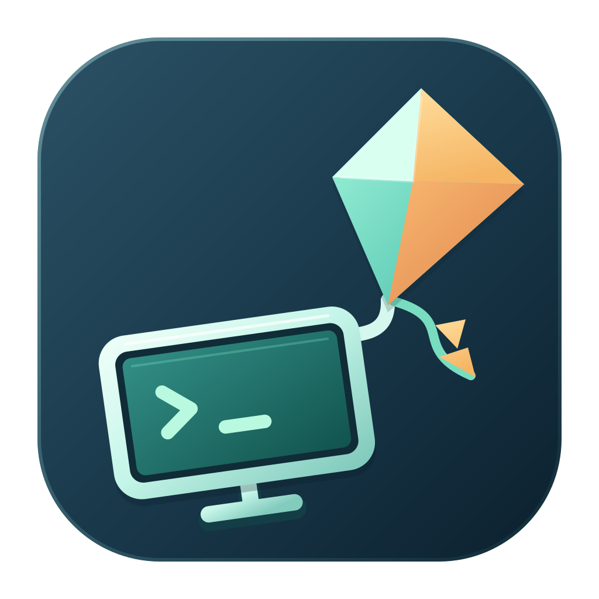
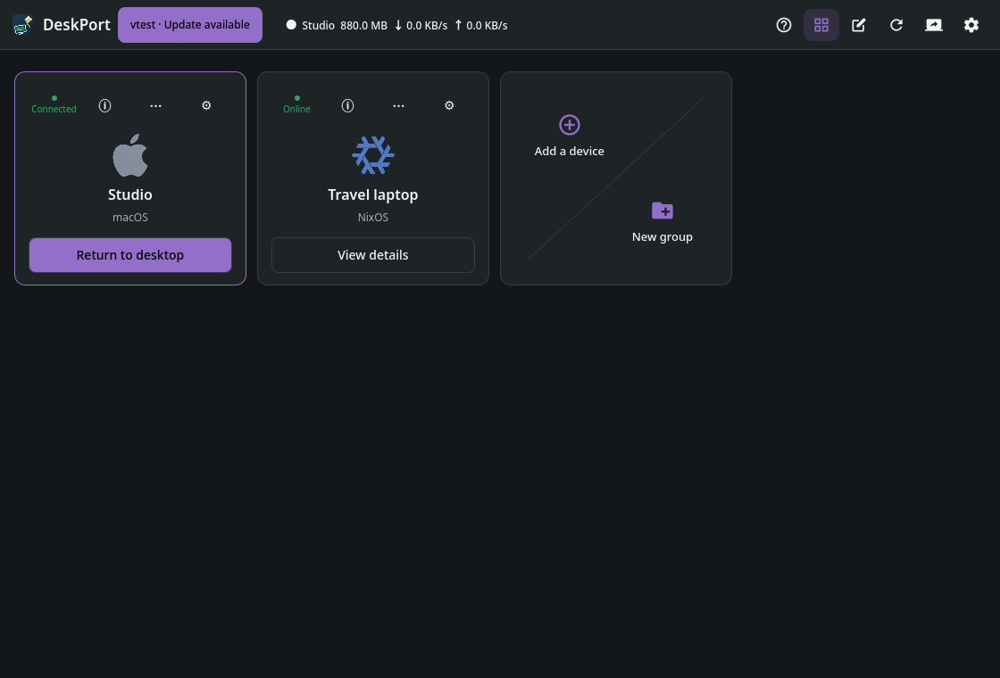
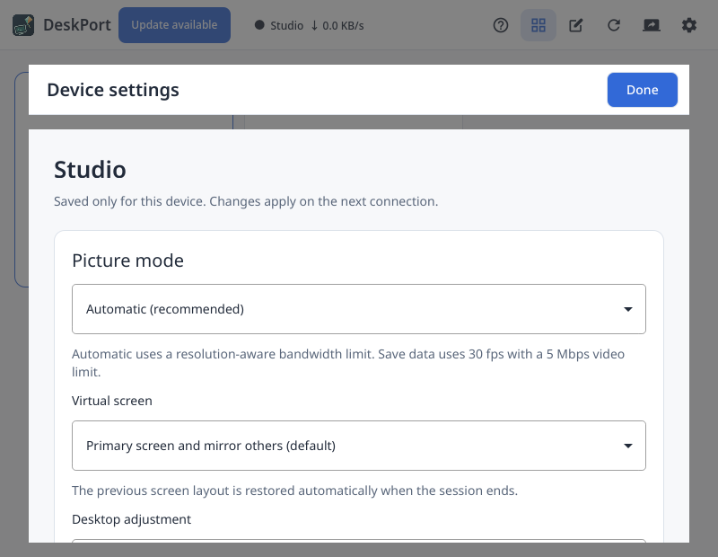
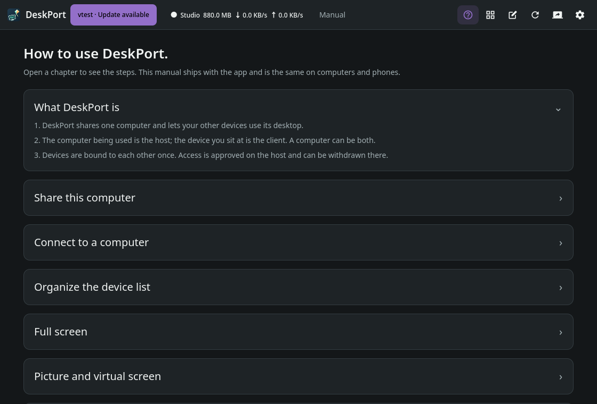

<p align="center">
  
</p>

<h1 align="center">DeskPort</h1>

<p align="center">
  <a href="../../README.md">English</a> ·
  <a href="README.zh-CN.md">简体中文</a> ·
  <a href="README.zh-TW.md">繁體中文</a> ·
  <a href="README.ja.md">日本語</a> ·
  <b>한국어</b> ·
  <a href="README.de.md">Deutsch</a> ·
  <a href="README.es.md">Español</a> ·
  <a href="README.fr.md">Français</a> ·
  <a href="README.pt-BR.md">Português (Brasil)</a> ·
  <a href="README.ru.md">Русский</a>
</p>

<p align="center">
  Moonlight와 Sunshine을 기반으로 한 원격 데스크톱 작업 공간입니다.<br>
  원격 데스크톱을 백그라운드에 대기시켜 두고, 한 번의 동작으로 현재 작업 공간에
  불러온 뒤, 다시 연결할 필요 없이 넣어 둘 수 있습니다.
</p>

<p align="center">
  <a href="https://github.com/keithxc/deskport/releases/tag/v0.7.2"></a>
  <a href="https://apps.apple.com/us/app/deskport/id6812389978"></a>
  <a href="../../LICENSE"></a>
</p>

---

## 주요 기능

- **보기와 공유를 하나의 데스크톱 앱으로.** Sunshine 내장, 기기 승인,
  독립적인 자격 증명과 설정. macOS, Windows, Linux 호스트 패키지는 Sunshine을
  따로 설치할 필요가 없습니다(뷰어 전용 Flatpak 제외).
- **클라이언트에 맞춰지는 작업 공간.** 호환되는 macOS 및 KDE 호스트에서의 적응형 크기 조정,
  HiDPI, 모바일 세로/가로 레이아웃, 기기별 크기 조정을 지원합니다.
  크기를 바꾸면 영상이 잠시 다시 연결되며, 끊김 없는 인코더 전환은 아닙니다.
- **호스트 디스플레이 정책 선택.** 다른 화면을 미러링하는 가상 기본 화면,
  다른 화면을 끈 가상 기본 화면, 또는 지원 호스트에서의 확장 작업 공간 중에서 고를 수 있습니다.
  세션이 끝나면 DeskPort가 저장된 레이아웃을 복원합니다.
- **승인된 기기 간 이동.** 활성 세션을 넘겨받기 전에 확인하며,
  밀려난 클라이언트는 인증된 인계 안내를 받습니다.
- **데스크톱 작업을 가까이에.** 연결된 뷰어를 숨기고 다시 불러올 수 있고, 숨겼을 때
  원격 입력을 해제하며, 로컬 공유와 별개로 보기 연결만 끊을 수 있습니다.
- **컴퓨터별 설정 저장.** 화면, 오디오, 입력, 데스크톱 조정, 주소 편집이
  기기별로 유지됩니다. 카드, 고정, 테마, 현지화된 인터페이스를 제공합니다.
- **필요할 때 데스크톱 클립보드 공유.** 텍스트는 즉시 업데이트되고,
  지원되는 이미지와 파일은 이 기능을 켠 연결된 데스크톱 기기 사이에서 요청 시 가져옵니다.
  [클립보드 범위와 제한](../CLIPBOARD.md)을 참고하세요.
- **네이티브 모바일 컨트롤.** iPhone/iPad와 개발 중인 Android 클라이언트는
  터치/트랙패드 입력, 키보드 컨트롤, 원격 데스크톱으로의 바로 진입을 제공합니다.
- **선택적 로그인 시 시작 및 macOS 복구.** 활성 그래픽 로그인과 시스템 승인이
  필요하며, FileVault를 잠금 해제하거나 대신 로그인해 주지는 않습니다.

## 인터페이스 미리보기

합성 데모 기기를 사용한 현재 인터페이스의 스크린샷입니다. 패널을 클릭하면
원본 크기 이미지를 볼 수 있습니다. 이 미리보기가 스토어 출시나 릴리스 제공을 의미하지는 않습니다.

| 기기와 그룹 | 기기별 화면 설정 | 내장 매뉴얼 |
| --- | --- | --- |
| [](../media/devices.png) | [](../media/device-settings.png) | [](../media/manual.png) |

## 지원 플랫폼

| 플랫폼 | 역할 | 릴리스 상태 | 다운로드 |
| --- | --- | --- | --- |
| macOS Apple Silicon, macOS 26+ | 뷰어 + 호스트 + 네이티브 가상 디스플레이 | **0.7.2 stable**, Developer ID 서명 및 Apple 공증 완료 | [DMG](https://github.com/keithxc/deskport/releases/download/v0.7.2/DeskPort-0.7.2-macos-arm64.dmg) |
| Linux x86_64 | 뷰어 + 호스트, 지원 KDE 호스트에서 적응형 가상 작업 공간 | **0.7.2 stable**: DEB, RPM, Arch, AppImage, 포터블 아카이브, Nix | [릴리스](https://github.com/keithxc/deskport/releases/tag/v0.7.2) · [설치 가이드](../LINUX_PACKAGES.md) |
| Linux x86_64 Flatpak | 뷰어 전용 | **0.7.2 stable**, Freedesktop Platform 25.08 | [릴리스](https://github.com/keithxc/deskport/releases/tag/v0.7.2) |
| iPhone / iPad, iOS/iPadOS 15+ | 클라이언트 전용 | App Store, 최신 빌드는 TestFlight에서 별도 테스트 | [App Store](https://apps.apple.com/us/app/deskport/id6812389978) |
| Android 8.0+ | 클라이언트 전용 | 개발 중, 실기기 검사 진행, 아직 공개 스토어 출시 없음 | 아직 제공되지 않음 |
| Windows x64 | 뷰어 + 호스트 + 가상 디스플레이 | **0.7.2 stable**, 설치 프로그램 및 포터블 ZIP, 아래 검증 범위 참고 | [설치 프로그램](https://github.com/keithxc/deskport/releases/download/v0.7.2/DeskPort-0.7.2-windows-x64-setup-full.exe) |
| Linux ARM64 / Intel Mac | 검증되지 않음 | 검증된 릴리스 패키지 없음 | — |

> **Windows 백신 안내:** 백신 프로그램이 DeskPort의 Windows 헬퍼 구성 요소를 오탐지할 수 있습니다.
> 자체 테스트에서는 이런 문제가 발생하지 않았습니다. Defender를 켜 둔 채로 사용하시고, 경고가 표시되면
> 릴리스 검증 보고서와 [샘플 이력](../WINDOWS_DEVELOPMENT.md#windows-antivirus-notice)을 확인하세요.

네이티브 Linux 패키지에는 glibc 2.39+가 필요합니다: Ubuntu 24.04+/Debian 13+, Fedora 44,
최신 Arch. AppImage에는 오래된 glibc 데스크톱을 위한 전용 런타임이 포함되어 있지만,
호스트 기능은 여전히 하드웨어 드라이버와 컴포지터 지원에 따라 달라집니다. KDE 가상 디스플레이 호스팅에는
컴포지터 권한 항목이 필요합니다. 네이티브/Nix 패키지는 고정 항목을 제공하며, 0.7.2
AppImage와 포터블 빌드는 공유를 시작할 때 현재 디스플레이 헬퍼 경로를 자동으로 등록합니다.
호스트 입력에는 여전히 장치 권한이 필요합니다. 모바일 앱은 데스크톱을 호스팅하지 않습니다.
소스 정의나 성공적인 컴파일만으로는 지원 플랫폼이 되지 않습니다.

## 설치

**macOS:** [공증된 DMG](https://github.com/keithxc/deskport/releases/download/v0.7.2/DeskPort-0.7.2-macos-arm64.dmg)를 열고,
DeskPort를 응용 프로그램 폴더로 끌어다 놓은 뒤 실행합니다. 호스트 기능을 사용하려면 화면 기록과
손쉬운 사용 권한을 허용하세요. Nix와 Homebrew는 필요하지 않습니다.

**Linux:** 시스템에 맞는 [0.7.2 패키지](https://github.com/keithxc/deskport/releases/tag/v0.7.2)를
선택하고 호스트 입력 권한을 포함해 [설치 가이드](../LINUX_PACKAGES.md)를 따르세요.
Nix 사용 시: `nix run github:keithxc/deskport/v0.7.2`.
Flatpak은 보기 기능만 제공합니다. 릴리스 자산에는 [SHA-256 체크섬](https://github.com/keithxc/deskport/releases/download/v0.7.2/SHA256SUMS.txt)과 [검증 보고서](https://github.com/keithxc/deskport/releases/download/v0.7.2/VERIFICATION.txt)가 포함되어 있습니다.

**iPhone / iPad:** [App Store에서 DeskPort](https://apps.apple.com/us/app/deskport/id6812389978)를 설치하세요.
모바일 앱은 유료 일회성 구매이며, 현재 현지 가격은 해당 스토어에서 확인하세요.
데스크톱 릴리스는 계속 무료이며 오픈 소스입니다. 구매 수익은 서명,
테스트 하드웨어, 지속적인 개발에 쓰입니다.

호스트에서 공유를 시작하고, 클라이언트에서 호스트를 선택한 뒤, 호스트에서 기기를
승인하세요. 두 기기 사이에 작동하는 네트워크 경로가 필요합니다. LAN이나 Tailscale 같은
자체 VPN을 사용하세요. DeskPort는 계정 서비스, 호스팅 데스크톱, 릴레이,
네트워크 터널을 제공하지 않습니다. 기존 Sunshine PIN 페어링도 계속 사용할 수 있습니다.

**0.7.2 안정 버전:** [데스크톱 릴리스](https://github.com/keithxc/deskport/releases/tag/v0.7.2)는 크기 조정, 원격 스트리밍, 데이터 절약, Linux 런타임 개선을 담고 있으며 Bazzite/KDE Wayland의 AppImage 문제를 수정했습니다. 자세한 내용은 [0.7.2 릴리스 노트](../RELEASE_0.7.2.md)를, 배포판별 Linux 설치 방법은 [영문 README](../../README.md#linux-installation-by-distribution)를 참고하세요.

**브라우저 접속:** 데스크톱 호스트는 30초 로그인 코드, 선택적 7일 브라우저 페어링,
적응형 크기 조정, 전체 화면을 갖춘 HTTPS 원격 데스크톱을 제공합니다.
[0.7.1 릴리스 노트](../RELEASE_0.7.1.md)와 [브라우저 가이드](../BROWSER_ACCESS.md)를 참고하세요.
AppImage에는 전용 glibc 런타임이 포함되어 있으며, 네이티브 패키지는 계속 glibc 2.39가 필요합니다.

### Linux 저장소 제공 현황

| 채널 | 상태 | 설치 |
| --- | --- | --- |
| GitHub 릴리스 패키지 | 제공 중, 0.7.2 | 위에서 배포판에 맞는 패키지를 다운로드 |
| 업스트림 Nix flake | 제공 중, 0.7.2 | `nix run github:keithxc/deskport/v0.7.2` |
| AUR `deskport-bin` | 레시피 테스트 완료, 신규 계정 등록 중단으로 게시 보류 | [로컬에서 레시피 빌드](../LINUX_PACKAGES.md#arch-linux-and-aur) |
| Nixpkgs `deskport` | [PR #572043](https://github.com/NixOS/nixpkgs/pull/572043) 리뷰 요청됨, 아직 병합되지 않음 | 포함될 때까지 업스트림 flake 사용 |
| Arch 공식 저장소 / Flathub | 등재되지 않음 | 릴리스 다운로드 사용, Flatpak은 뷰어 전용 |

다운로드한 Arch 패키지는 `pacman -U`로 설치하며, 이것으로
`pacman -S deskport`를 사용할 수 있게 되지는 않습니다. 마찬가지로 업스트림 flake가 Nixpkgs에서
`pkgs.deskport`를 사용할 수 있게 해 주지는 않습니다. 호스트 입력, 캡처 권한, 방화벽
설정은 애플리케이션 설치와 별개입니다.
[Linux 설치 가이드](../LINUX_PACKAGES.md#nixos-and-nix)를 참고하세요.

## 유사 제품과의 비교

이 표는 워크플로와 플랫폼 비교이며, 링크된 공식 문서를 **2026-09-20**에 확인한 내용입니다.
지연 시간이나 화질 벤치마크가 아닙니다. 제품 기능과 플랫폼 제한은 바뀔 수 있습니다.

| 항목 | DeskPort | Moonlight + Sunshine | RustDesk | Parsec |
| --- | --- | --- | --- | --- |
| 주요 워크플로 | 상시 원격 데스크톱 작업 공간, 적응형 크기 조정, 기기 간 인계 | 별도의 클라이언트·호스트 앱을 통한 게임/데스크톱 스트리밍 | 범용 원격 제어 및 지원 | 대화형 원격 데스크톱 및 협업 |
| 데스크톱 호스트 플랫폼 | macOS Apple Silicon, Linux x86_64, Windows x64 | Windows, macOS, Linux, FreeBSD(플랫폼별 제한 있음) | Windows, macOS, Linux | Windows, macOS; Linux는 호스트 불가 |
| 데스크톱 클라이언트 | macOS Apple Silicon, Linux x86_64, Windows x64 | Windows, macOS, Linux 등 | Windows, macOS, Linux | Windows, macOS, Linux, 지원되는 Chromium 브라우저 |
| 모바일 클라이언트 | iPhone/iPad 출시, Android 개발 중 | iOS/iPadOS, Android | iOS/iPadOS, Android; iOS는 호스트 불가 | Android; iOS/iPadOS 클라이언트 없음 |
| 설정 방식 | 네이티브 데스크톱 패키지에 호스트 내장, DeskPort에서 기기 승인 | Sunshine을 별도 설치·설정한 뒤 Moonlight와 페어링 | 공용 서버 인프라 또는 자체 호스팅 서버 | Parsec 계정과 애플리케이션 |
| 네트워크/서비스 방식 | LAN/VPN 연결은 직접 마련, DeskPort 릴레이 없음 | 자체 호스팅 스트리밍, 네트워크 연결 직접 설정 | 공용 인프라 또는 자체 호스팅 OSS/Pro 서버 | Parsec 계정/서비스 인프라 |
| 소스와 배포 | GPL 데스크톱, 무료 데스크톱 패키지, 유료 Apple 앱은 별도 배포 | 오픈 소스 클라이언트와 호스트 | 오픈 소스 클라이언트와 OSS 서버, 상용 Pro 서버 옵션 | 독점 애플리케이션/서비스 |

출처: [Moonlight](https://moonlight-stream.org/),
[Sunshine installation and platform support](https://docs.lizardbyte.dev/projects/sunshine/latest/md_docs_2getting__started.html),
[RustDesk clients](https://rustdesk.com/docs/en/client/),
[RustDesk self-hosting](https://rustdesk.com/docs/en/self-host/),
[Parsec platform compatibility](https://support.parsec.app/hc/en-us/articles/32381568346644-Hardware-and-Software-Compatibility),
[Parsec Linux setup](https://support.parsec.app/hc/en-us/articles/32381552552340-Install-Parsec-App-on-Linux).
DeskPort의 현재 플랫폼 제한은 위에 나와 있으며, 이 표가 모든 OS에서의 기능 동등성이나
측정된 성능 우위를 의미하지는 않습니다.

[0.7.2 릴리스 노트](../RELEASE_0.7.2.md),
[아키텍처](../ARCHITECTURE.md), [로드맵](../ROADMAP.md)을 참고하세요.

## Linux에서 빌드 및 실행

Nix와 flakes를 활성화한 상태에서:

```sh
git clone https://github.com/keithxc/deskport.git
cd deskport
nix build
./result/bin/deskport
```

뷰어의 서드파티 소스 의존성은 저장소에 포함(vendored)되어 있으며, 공유 코어와
Nix 빌드 입력은 고정된 외부 의존성으로 남아 있습니다. 네이티브 빌드에서는
`shared/deskport-core`를 초기화해야 합니다. [docs/VENDORED.md](../VENDORED.md)를 참고하세요.
SSH 설정, 로컬 호스트 관리, VPS 사전 요구 사항, Omarchy/Hyprland에 대해서는
[CLI 가이드](../CLI.md)를 참고하세요. `deskport doctor`는 호스팅 사전 요구 사항을 점검하고,
`deskport status --json`은 창을 열지 않고 실행 중인 인스턴스를 확인합니다.
`nix run . -- --help`는 명령줄 인터페이스를 보여 줍니다. 연결하기 전에 호스트에서 공유를 시작하고 기기를 연결하세요. 기존
Sunshine PIN 페어링도 사용할 수 있습니다. 개인 호스트나 페어링 자격 증명은
포함되어 있지 않으며 Moonlight에서 가져오지도 않습니다.
새로 입력하는 수동 주소는 기본적으로 DeskPort 포트 `48989`를 사용합니다. 다르다면 호스트 공유 페이지에
표시된 포트를 함께 입력하거나, 기본 설정의 독립 Sunshine 설치에 명시적으로 연결하려면
`host:47989`를 사용하세요. 저장되었거나 검색된 엔드포인트는 각자의 포트를 유지합니다.

편집 가능한 네이티브 빌드:

```sh
git submodule update --init shared/deskport-core
nix develop
mkdir -p build
cd build
qmake ../moonlight-qt.pro CONFIG+=disable-prebuilts
make -j4
./app/deskport
```

포크를 검토하기 쉽도록 업스트림 프로젝트의 파일 이름은 그대로 유지합니다.

## Moonlight와 무엇이 다른가요?

- 기기 승인, 세션 인계, 기기별 설정을 갖춘 Sunshine 호스트 내장.
- 뷰어를 숨겨도 세션은 연결된 상태로 유지되며, 트레이/메뉴 막대에서 다시 불러올 수 있습니다.
- 데스크톱 호스트가 제공하는 HTTPS 브라우저 접속.
- 별도의 `deskport` 실행 파일, `DeskPort` Qt 설정 네임스페이스,
  `io.github.keithxc.DeskPort` Linux 애플리케이션 ID.
- 기본값으로 창 모드 스트리밍과 절대 포인터 제어.
- 포커스를 잃으면 음소거. 게임 최적화, 게임패드 마우스, 멀티 컨트롤러 모드,
  백그라운드 게임패드 입력, Discord 상태 표시는 기본적으로 비활성화.
- 이 독립 애플리케이션에는 업스트림 Moonlight 업데이트 알림이 표시되지 않습니다.
- 고정된 Nix 환경과 Linux 빌드 워크플로.

데스크톱 인터페이스는 기기, 공유, 설정 페이지를 제공하며, 언어 선택과
별도의 호스트 권한을 갖추고 있습니다. 뷰어를 닫아도 세션은 유지되고 기기 목록이 열립니다.
활성 기기에는 '데스크톱으로 돌아가기'가 표시되고, 다른 기기는 현재 세션이 끊어질 때까지
세부 정보만 표시합니다. 자주 쓰는 기기를 고정하고 간결한 목록이나 카드 보기를 선택할 수 있습니다.
외관은 시스템 설정을 따르며, 라이트/다크 모드로 강제 지정할 수도 있습니다.

## 플랫폼 범위

플랫폼별 릴리스 상태는 위의 [플랫폼 표](#지원-플랫폼)를 참고하세요.
데스크톱 릴리스는 macOS Apple Silicon, Linux x86_64, Windows x64에서 뷰어와 호스트를
모두 지원하며, 모바일 앱은 클라이언트 전용입니다.

클라이언트 플랫폼 지원과 호스트 지원은 별개입니다. Mac 호스트에 DeskPort Mac 클라이언트가
필요하지는 않습니다. 하드웨어 디코딩, 실시간 입력, 화질, 호출 지연 시간은 실제
세션 테스트가 필요하며, 빌드가 성공했다고 해서 이를 입증하지는 않습니다.

## 다음 마일스톤

**50회의 숨기기/표시 주기** 동안 하나의 세션을 연결 상태로 유지하고, 창을 현재
작업 공간에 표시하며, 로컬 입력을 안정적으로 되돌려 줍니다. 새 프레임 지연 시간과
백그라운드 리소스 사용량은 창 표시와 별도로 측정합니다.

수용 기준과 연기된 기능은 [로드맵](../ROADMAP.md)을,
출처와 유지 관리 경계는 [업스트림 노트](../UPSTREAM.md)를 참고하세요.

## 검증

```sh
nix build
python3 scripts/deskport-smoke.py ./result
```

스모크 검사는 임시 XDG 설정/캐시 디렉터리와 오프스크린 Qt 플랫폼을 사용합니다.
호스트와 페어링하거나 스트림을 시작하거나 입력을 주입하지 않습니다.

## 일상적인 데스크톱 조작

창을 닫아도 DeskPort는 트레이/메뉴 막대에서 계속 실행됩니다. **Open DeskPort**로
다시 불러오고, **Disconnect viewer**로 현재 연결만 종료하거나,
**Quit DeskPort**로 서비스를 종료하세요. 뷰어를 닫아도 로컬 공유는 계속됩니다.

일반 텍스트 클립보드 공유와 시스템 단축키 캡처는 연결된 두 기기 모두에서 기본적으로
활성화되어 있습니다. 설정 변경은 다시 연결한 뒤 적용됩니다. 새로 복사한 내용만
최대 1 MiB까지 공유됩니다. 지원되는 이미지와 파일은 이 기능을 켠 호환 데스크톱 기기 사이에서
요청 시 가져옵니다. [제한 사항](../CLIPBOARD.md)을 참고하세요. 데스크톱 포인터 모드에서는
포커스된 영상 안에서 키보드 입력이 포인터를 따라갑니다.
**Ctrl+Alt+Shift+Z**는 입력을 해제하고,
**Ctrl+Alt+Shift+Q**는 뷰어 연결을 끊습니다. 명시적으로 해제한 뒤에는 안쪽을 클릭하면
입력을 다시 가져옵니다. OS 예약 단축키는 데스크톱 컴포지터에 따라 다릅니다.

로그인 시 시작과 복구에는 활성 그래픽 로그인 세션이 필요합니다. 무인 접속을 위해 컴퓨터에
의존하기 전에 [수용 검사와 제한 사항](../INPUT_SERVICE_ACCEPTANCE.md)을 확인하세요.

## 라이선스 및 출처

DeskPort는 [Moonlight Qt](https://github.com/moonlight-stream/moonlight-qt)의 독립 파생 프로젝트로,
처음에는 v6.1.0을 기반으로 했습니다. 공식 Moonlight 또는 Sunshine 릴리스가 아닙니다.
Moonlight가 스트리밍 기반을 제공하며, [Sunshine](https://github.com/LizardByte/Sunshine)은
macOS, Windows, Linux 호스트 패키지에 포함되어 있고(뷰어 전용 Flatpak 제외) Linux Nix 패키지로도 제공됩니다.
별도로 설치한 Sunshine 서비스와는 독립적으로 유지됩니다.

GPL-3.0-or-later입니다. [LICENSE](../../LICENSE), 보존된 소스 고지, 그리고
[docs/VENDORED.md](../VENDORED.md)에 나열된 각 포함 의존성의 라이선스를 참고하세요. 원본 문서는
[README.upstream.md](README.upstream.md)에 보존되어 있습니다.

### 진단 및 피드백

진단 로그는 기본적으로 활성화되어 있습니다. 문제를 재현한 뒤
로그 ZIP을 만들고 GitHub 이슈 초안을 여세요. 첨부하기 전에 ZIP 내용을 검토하세요.
GitHub 이슈는 공개되며, DeskPort가 대신 업로드하거나 제출하지 않습니다.
[진단 데이터와 제한](../DIAGNOSTICS.md)을 참고하세요.
